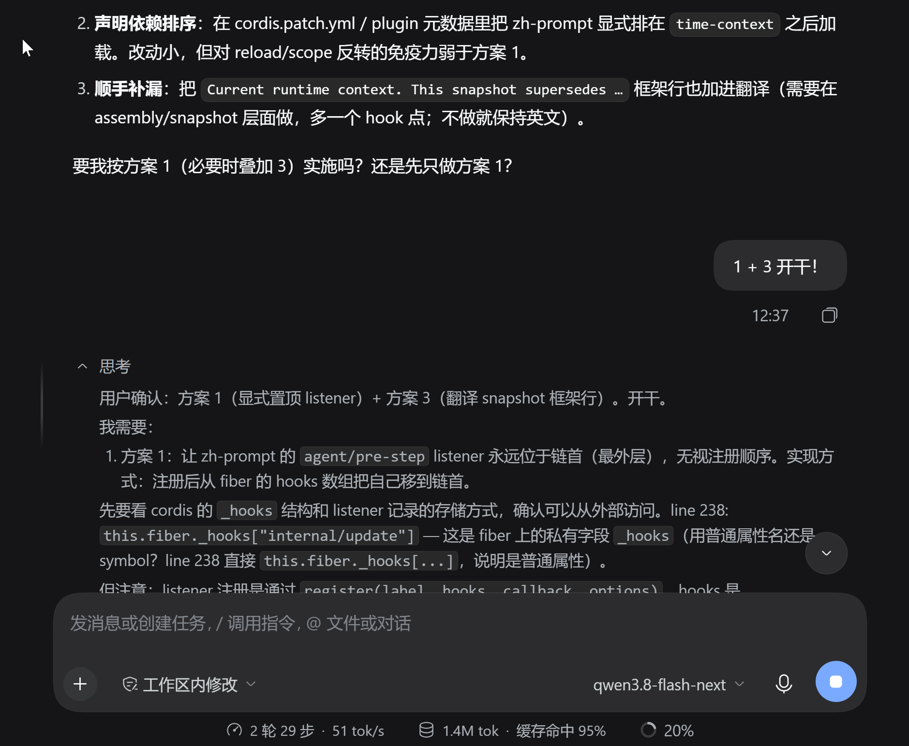

# dsh-zh-prompt

> English | [中文](./README.md)

A toggleable plugin that rewrites DSH's **system prompt sections, tool schema descriptions, runtime context snapshot, time-context message, skill catalog message, and compaction summarization instructions** into Chinese.

## Why rewrite the prompt into Chinese

What language a model uses for its chain of thought is driven mainly by **the input**: whichever language dominates the context pulls the thinking toward it. Even when the user converses entirely in Chinese, the system prompt, tool descriptions, and runtime context the agent reads are still all English — a small patch of Chinese drifting in an ocean of English, so the chain of thought naturally slides back into English. The reply language matching the user's is a separate result of special alignment training: it governs the final output only, not the thinking. Therefore, to get a Chinese chain of thought, the prompt feed to the model must itself be Chinese — a Chinese conversation plus one "please think in Chinese" line cannot outweigh the pull of a wall of English.

Why insist on a Chinese chain of thought? Three reasons:

1. **Readable**: Chinese users can read the chain of thought directly, with no extra translation step.
2. **Coherent**: A wall of English keeps dragging the thinking toward English, forcing the model to switch back and forth between languages; mixed-language reasoning pulls in opposing directions and degrades thinking quality.
3. **Cheaper**: The same content written in Chinese usually encodes into fewer tokens (especially for models with a high Chinese share in the vocabulary); the longer the chain of thought, the more it saves.

## screenshot




## How the plugin works

For this reason the plugin does not merely append a Chinese instruction — it rewrites **every English source** in the prompt: sections, tool schemas, runtime context, time-context, the skill catalog, and compaction instructions — so that the input the model sees is predominantly Chinese to begin with. Each bullet below is one implemented piece.

- **Sections / tool schemas**: hooked onto the `system-prompt/assemble` waterfall, performing exact "English original → Chinese" replacements entry by entry over the assembled assembly; dynamic text is handled by regex rules (goal guidance, workflow/subagent delegation hints, team policy, MCP resource server).
- **Runtime context snapshot**: `refreshContext()` reruns providers on every step, so editing contexts in the waterfall would be overwritten; the plugin therefore wraps the `text` function of already-registered context entries directly (provider output passes through translation), and patches newly registered entries on `system-prompt/change` (a WeakSet keeps this idempotent). Covers working directory, file policy, approval policy, checkout/GUI URL, subagent depth, and team identity. The snapshot framework header line is hardcoded by `joinContextSections` and cannot be rewritten at the append site (dedup relies on verbatim equality, so translating it would re-append the snapshot every step); instead a context entry with the lowest order emits a Chinese counterpart line, and the English header stays.
- **time-context**: a user message injected at `agent/pre-step`. This plugin's listener registers with `prepend: true` and hoists itself to the head of the hook chain before every `agent/pre-step` dispatch (via an `internal/dispatch` listener) — cordis `prepend` only guarantees "registered later sits further out", and the registration order between this plugin and the base time-context varies with plugin load order, so when this plugin registers first it sits inside and never sees the time message (the old version silently lost translation in some processes). After hoisting this listener is always outside time-context: `await next()` receives the final decision with the time message already appended, translates it, and returns it — the durable log and payload both become Chinese.
- **Skill catalog (`<available_skills>`)**: `dsh-tool-skill` maintains a persistent user message with `source.kind === "skill-catalog"` at `agent/pre-step` (injected on first use, then fully replaced from two templates whenever it changes). This plugin reuses the same prepend listener: English template lines are matched exactly, line by line; entry lines look up the description map by skill name and are replaced only when the **English original matches verbatim** (if the upstream description changed, English is kept so a stale translation cannot overwrite new semantics). Only the `content` text is rewritten — id and `source` are preserved, and the upstream digest comparison only inspects `source.entries`, so body text never triggers a resend. The `<system-reminder>`/`<available_skills>` tags are protocol frames and stay untouched.
- **Compaction summary**: summary generation during compaction is a separate `ctx.llm.stream()` helper call (`purpose === "compaction"`) whose English instruction explicitly demands "Write concise English engineering prose", so checkpoints come out fully English and drag later thinking back toward English. This plugin's global `llm/stream` listener **replaces the last element of `messages` in place** with a Chinese instruction (Chinese prose required; paths/commands/identifiers stay in the original) for such requests. Key facts: cordis waterfall `next` ignores its argument, but dsh-llm's leaf closure captures the same options object and this call's `messages` is a fresh mutable array, so the in-place replacement propagates to the actual request; this path has no agent-loop deepFreeze / `INVALID_PREPARED_CALL` restrictions. The instruction is the last message, so the prefix KV cache is unaffected. Old English checkpoints are rewritten into Chinese on the next compaction via the instruction's PRIOR merge rule; the `CHECKPOINT_PREAMBLE` framework line and English records in the durable log stay as-is (no hook point).
- Text that is not covered (new paragraphs after a DSH upgrade, MCP server instructions, subagent personas, etc.) is **kept in English verbatim**. A failed replacement only falls back; it never corrupts the prompt.
- A Chinese language convention is additionally inserted after the persona position: internal reasoning (thinking) must be written in Chinese, and it states explicitly that English in the context or tool output is not a reason to switch thinking back to English.
- **Per-turn language anchor**: time-context is injected every turn and sits closest to the model; when the translation hits, one anchor line is appended at its end ("Language anchor: no matter how much English appears in this turn's context and tool output, thinking must be written in Chinese" — the injected line itself is Chinese), counteracting the recency pull of English tool output. The anchor is appended only on the translation-hit branch (a miss falls back to verbatim original, no anchor), and an idempotency check on hits prevents stacking.
- Toggle: enable/disable the `zh-prompt` row in the plugin manager; takes effect immediately. Disabling returns to the standard English mode.

## Installation (sharing with others)

Pick either method below; the package has no dependencies. After installing, toggle Chinese/English via the `zh-prompt` row in the plugin manager, effective immediately. Note: the plugin relies on verbatim matching of upstream English text — on a different DSH version, unmatched parts silently fall back to English and never corrupt the prompt.

### Method 1: GitHub repository URL

Type this repository's address directly into the "Add plugin" input field in the DSH plugin UI:

```
https://github.com/microcai/dsh-zh-prompt#v0.6.2
```

`#v0.6.2` pins the installation to that tag; without `#...` the latest commit of the default branch is installed. DSH first checks repository connectivity anonymously, then clones and installs — no npm publishing required. Prerequisites and caveats:

- The repository must be public — the pre-install connectivity check carries no credentials, so private repos fail with "cannot reach GitHub".
- The other machine's network must be able to reach GitHub. Direct connections from mainland China often time out; in that case configure a git proxy first, or use Method 2 with a tgz instead. The registry mirror in the dialog only affects npm package-name lookups and does nothing for GitHub addresses.
- If `@local/dsh-zh-prompt` is already installed there (e.g. an older tgz), uninstall it before installing.
- Upgrading: uninstall, then reinstall; when releasing a new version, remember to create a new tag and push it.

### Method 2: tgz file

Just send them `local-dsh-zh-prompt-<version>.tgz` (the `npm pack` artifact). They need neither the source tree nor access to GitHub. In their own DSH they tell the agent: "install `file:/absolute/path/local-dsh-zh-prompt-0.6.2.tgz`", and let it use the plugin manager's `install_bundle` (pass that `file:` spec as the target). Suitable when their network cannot reach GitHub or you do not want to publish the repository.

## Development (local machine)

The profile loads the copy installed from the tgz, **not the working directory directly**. Workflow after editing code: `npm pack` regenerates the tgz → `plugin_manager` `remove_bundle @local/dsh-zh-prompt` → `install_bundle file:<absolute path of the new tgz>`. The entry filename (currently `entry7.js`) doubles as a way to bypass Node's ESM module cache — rename the entry (or bump the version) before reinstalling whenever the code changes, otherwise the old module may be loaded. Under the sandbox, `npm pack` needs `npm_config_cache` pointing at a writable directory.

## Differences from the standard mode

The only difference is language: section structure, order, tool set, and context snapshot structure are unchanged. Note that the `"If you intend to call multiple tools..."` paragraph is not part of DSH source (it is injected by the model gateway), so it cannot be translated.
